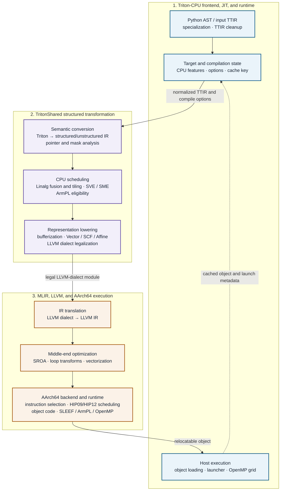
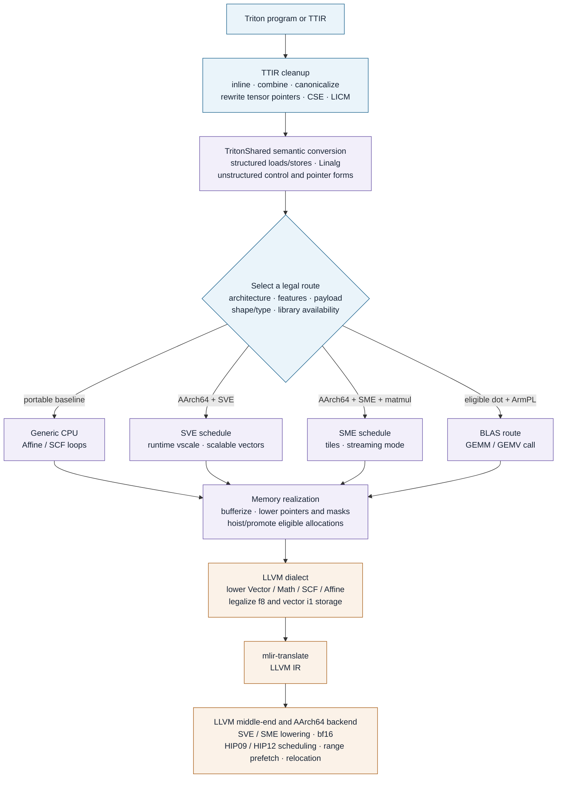

# Triton-CPU on AArch64: Compiler and LLVM Design

> A layered design for CPU JIT compilation, structured lowering, target
> specialization, and LLVM code generation.

This document was derived from the following branch snapshots:

- Triton-CPU `master` at `04c99f19`
- LLVM `dev_20.1.8` at `29238fea`
- Review date: 23 October 2026

It describes the architecture represented by the branches as a whole. Commit
references provide design evidence; they are not authorship boundaries or a
complete changelog.

## 1. Purpose

Triton-CPU compiles Triton programs for general-purpose CPUs while exploiting
AArch64 facilities available on Kunpeng-class machines. The design separates
three concerns: the JIT and host runtime, structured MLIR transformation, and
LLVM/AArch64 code generation. A portable route remains available when a target
feature, transform, or optional numerical library cannot be used.

The central design rule is:

> Preserve Triton program semantics through explicit IR contracts, then
> specialize behind capability and legality checks. Target tuning may change
> schedules, tiling, vector width, library calls, and launch policy; it must not
> change memory, masking, reduction, or numerical contracts.

## 2. Layered architecture

Each layer owns a stable contract:

| Layer | Responsibilities | Boundary contract |
|---|---|---|
| Triton-CPU JIT/runtime | TTIR normalization, CPU feature discovery, compilation options and cache identity, artifact management, launcher generation, thread policy, and object loading | Owns the compilation lifecycle, host ABI, target-route inputs, and dispatch behavior |
| TritonShared/MLIR | Triton-to-structured conversion, pointer and mask analysis, Linalg formation, tiling, fusion, bufferization, vector lowering, and optional ArmPL routing | Preserves program semantics while replacing tensor and pointer abstractions with scheduled CPU operations |
| MLIR/LLVM/AArch64 | Dialect legalization, LLVM IR optimization, instruction selection, machine scheduling, relocation, and object generation | Produces legal executable code for the selected triple and feature set without weakening the upstream contracts |

Cross-layer fixes belong at the lowest layer that can state and enforce the
violated invariant. The same target triple and feature decision must follow an
artifact from transform selection through LLVM optimization and `llc`.

### 2.1 Artifacts at the boundaries

| Artifact | Producer | Required information |
|---|---|---|
| TTIR | Triton frontend or an input MLIR file | Specialized argument types, constants, program identifiers, pointer operations, masks, and numerical operations |
| TritonShared IR | Structured conversion and target transforms | Linalg/SCF/Affine/Vector operations, explicit memory effects, buffer lifetimes, and any selected SVE, SME, or library schedule |
| LLVM IR | MLIR LLVM-dialect lowering and `mlir-translate` | Kernel entry ABI, target-independent SSA, external declarations, and legal storage types |
| Object plus metadata | LLVM `opt`/`llc` and Triton-CPU | Relocatable machine code, entry symbol, thread policy, and cache-relevant options; grid dimensions remain runtime inputs |

## 3. Compilation and execution flow

The backend registers four externally visible stages: `ttir`, `ttsharedir`,
`llir`, and `obj`. Within them, the pipeline introduces finer-grained forms.
Target scheduling happens while structured intent is still available; all
routes converge at LLVM-dialect legalization and use the same host-facing
kernel ABI.

### 3.1 Target routes

| Route | Selection intent | Primary transformations | Fallback or guardrail |
|---|---|---|---|
| Generic CPU | Non-AArch64 target or no supported vector facility | Linalg to Affine/SCF loops, bufferization, and Vector to LLVM | Baseline semantic path with no target-only assumptions |
| SVE | AArch64 reports SVE, or an explicit test override is active | Runtime vscale detection, scalable-vector tiling, vectorization, and lowering | Detection failure is explicit; unsupported forms retain generic lowering |
| SME | SME is present and the payload contains an eligible matmul | Matmul tiling, vectorization, bufferization, streaming-mode annotation, and SME lowering | Selection is per kernel; `+sme` is not passed for a kernel scheduled only for SVE |
| ArmPL | The library is loadable and a `tt.dot` shape and type are supported | Selected dot operations become structured GEMM/GEMV operations and then `cblas_*` calls | `TRITON_SHARED_DISABLE_ARMPL` and normal Linalg lowering preserve an escape path |

A fast path is enabled only by proven capability. Fallback means compiling the
same TTIR semantics through a supported route; it must not silently substitute
different memory or numerical behavior.

### 3.2 JIT and launch lifecycle

Compilation options are immutable inputs to a compiled artifact. Options such
as fast math, ArmPL use, SME tiling, streaming-mode vectorization, and machine
scheduling therefore participate in `CPUOptions.hash()`. CPU feature and SVE
vscale discovery are cached at backend scope because they are comparatively
expensive, while the decision that a particular kernel uses SME is reset for
each compilation.

The object entry symbol is recorded in metadata. At launch, pointer-like Python
arguments are converted to data addresses and then to the memref-shaped ABI
expected by the kernel. Grid coordinates are flattened for work distribution
and reconstructed for each invocation. A one-program grid runs inline; larger
grids use a statically scheduled OpenMP loop capped by both the configured
thread count and the amount of work.

## 4. Correctness contracts

Most failures in the reviewed history occur where one representation becomes
another: tensor pointers become analyzed access domains, tensors become
buffers, masks become guarded memory operations, or uncommon scalar types
become legal LLVM storage. The design therefore assigns an invariant to every
boundary.

### 4.1 TTIR and JIT state

- Inlining, canonicalization, CSE, LICM, tensor-pointer rewriting, and symbol
  elimination preserve side effects and program-ID semantics.
- Every option that can change generated code participates in cache identity;
  cached objects are not reused across incompatible target policies.
- CPU architecture, feature strings, and vscale are discovered once, but
  payload-dependent route selection is made independently for every kernel.
- Route forcing exists for testing and diagnosis; it does not manufacture
  execution-time hardware support.

### 4.2 Structured lowering

- Pointer analysis preserves offsets, wraparound, scalar accesses,
  gather/scatter domains, and atomic value kinds.
- Masked operations do not access inactive lanes. A full-tile bypass is legal
  only when its runtime or static precondition is proven.
- Reductions retain their combiner, identity, axis, accumulator type, and
  reassociation policy through vectorization.
- Bufferization honors aliasing and copy-before-write requirements for
  loop-carried values; allocation hoisting and stack promotion must not change
  lifetime or cause unbounded stack growth.

### 4.3 LLVM IR and machine code

- Storage legalization preserves bits and lane count. Float8 memory operations
  use `i8`; vector `i1` memory operations use byte-addressed `i8` with explicit
  conversion.
- Transformations operate only on non-empty, legal regions and operand domains.
- SVE vector length is scalable; a fixed-width assumption requires explicit
  proof. SME streaming-mode attributes and target features must agree.
- `opt` and `llc` receive compatible target triples and feature flags so that
  vectorization cost modeling, data layout, instruction selection, and machine
  scheduling describe the same processor.
- HIP09/HIP12 models, bf16 lowering, relocation, and final scheduling remain
  responsibilities of the AArch64 backend.

### 4.4 Host ABI and execution

- Kernel metadata preserves the entry name and CPU thread count; launch inputs
  carry the grid shape separately.
- Arguments retain their source ordering; compile-time constants are omitted
  from the call ABI without shifting the meaning of remaining arguments.
- Each grid point receives stable `(gridX, gridY, gridZ, x, y, z)` values, with
  identical semantics in the serial and OpenMP paths.
- Launcher-module and object caches may remove repeated setup work, but they do
  not bypass argument validation or launch hooks.

## 5. Performance policy

Performance work remains separated by responsibility:

| Level | Policy |
|---|---|
| Structured compiler | Fuse and tile Linalg, select SVE/SME schedules, version full tiles, reuse buffers, fold copies, and route supported contractions to ArmPL |
| LLVM pipeline | Expose scalar replacement and vectorization opportunities, provide accurate target information, legalize scalable vectors, and preserve useful memory attributes |
| Runtime | Cache feature queries, launcher modules, and compiled objects; avoid parallel-region overhead for one grid point; cap OpenMP workers by available work |

Placement rule for a change:

1. If it concerns TTIR specialization, target-route selection, cache identity,
   launch, or artifact loading, place it in Triton-CPU.
2. If it concerns Triton-to-CPU semantics, memory realization, tiling, fusion,
   or route-specific MLIR, place it in TritonShared.
3. If it applies to legal MLIR/LLVM or AArch64 machine code independently of
   Triton, place it in LLVM.
4. If a defect spans boundaries, add a focused test at every boundary needed to
   prevent the incompatible states from recurring.

## 6. Operational controls

| Control | Purpose | Design constraint |
|---|---|---|
| `TRITON_SHARED_DISABLE_ARMPL` | Force generated Linalg code instead of ArmPL | The setting alters compilation options and cache identity |
| `TRITON_SHARED_FORCE_SVE_PIPELINE` | Exercise SVE scheduling during tests and debugging | It does not manufacture hardware support at execution time |
| `TRITON_SHARED_FORCE_SME_PIPELINE` | Exercise SME scheduling during tests and debugging | The backend warns when the payload has no matmul |
| `TRITON_SHARED_SME_MATMUL_K_TILE` | Set the SME matmul K tile | Values affect the schedule and belong in the compilation key |
| `TRITON_SHARED_ENABLE_SME_STREAMING_AUTOVEC` | Allow scalable autovectorization in streaming mode | The default remains conservative and explicit |
| `TRITON_SHARED_DISABLE_MACHINE_SCHEDULER` | Trade scheduling quality for compile-time reduction | Scheduled and unscheduled objects must never share a cache entry |
| `TRITON_SHARED_DUMP_PATH`, `MLIR_ENABLE_DUMP` | Expose per-stage and per-pass artifacts | Diagnosis must not change semantic pipeline decisions |
| `TRITON_PRINT_COMPILE_TIME` | Report time spent in backend stages | Measurement must remain observational |

## 7. Branch evidence

The commits below are representative examples selected for architectural
significance.

### 7.1 Triton-CPU `master`

**Vector and target scheduling**

- `a6f3a03c`: runtime SVE vscale detection
- `568e013a`, `bc9faa26`: multi-reduction lowering
- `dd726924`: per-kernel SME state isolation
- `c92180b0`: K-axis matmul tiling
- `a13b626a`: streaming-mode autovectorization control

**Memory and representation**

- `cb546a5f`: float8 memory conversion
- `f9c61b11`: vector-`i1` memory promotion
- `c8979cc9`, `609f9d68`: pointer-boundary repairs
- `1382ebeb`, `17efe495`: atomic lowering and semantics
- `f2a87f70`: buffer reuse inside loops

**Compilation and runtime cost**

- `41502371`, `4a1af873`: ArmPL eligibility corrections
- `5acdd35d`: ArmPL opt-out control
- `27d57d64`: fast-math controls across LLVM IR and `llc`
- `5c43b744`: cached CPU-backend introspection
- `e0b57c65`, `5990b3c0`: launcher and OpenMP improvements

### 7.2 LLVM `dev_20.1.8`

**Target models and code generation**

- `240b71d1`: HiSilicon HIP12 scheduling model
- `3f210c06`: HiSilicon HIP09 scheduling model
- `dda389ea`, `415eec69`: SVE and SME lowering support
- `d10cdbc1`, `ea6097ec`, `c4e8bbf4`: AArch64 bf16 lowering and cost work

**MLIR legality**

- `f5ee4eed`, `6e8803fe`: float8 registration and memory legalization
- `f27b622d`: masked-load support in float8 legalization
- `1df7dfc1`: vector-`i1` memory promotion
- `342f2196`: scalable-vector support for `i1` promotion

**Transforms and bufferization**

- `014e2f22`, `9104fecf`: safe region handling
- `2bc5760b`: gather-to-masked-load legality
- `15549075`: copy-before-write bufferization control
- `222b42d0`: SME-to-control-flow lowering sequence
- `77ca9a9d`, `32267ad3`: Linalg vectorization and flattening fixes

The branch also contains AArch64 range-prefetch, SVE memcpy versioning,
relocation, weak-consistency, and OpenMP work. Generated kernel performance
therefore depends on platform and runtime policy as well as instruction
selection.

## 8. Validation strategy

| Level | Required evidence | Important dimensions |
|---|---|---|
| TTIR | Frontend and canonicalization tests | Constants, program IDs, tensor pointers, side effects, and unusual scalar types |
| Transform | MLIR lit/FileCheck tests for rewrite preconditions and resulting IR | Rank zero, scalable vectors, empty regions, masked lanes, f8/i1, atomics, and aliasing |
| Compiler route | TritonShared conversion tests and forced-route tests | Generic, SVE, SME, and ArmPL paths; accepted and rejected contractions; cache-option separation |
| LLVM | IR checks plus object and feature inspection | Triple/data layout consistency, SVE vector lengths, SME attributes, HIP09/HIP12 scheduling, and relocation |
| Runtime | Compiled-kernel comparisons and launcher tests | Serial/parallel grids, pointer arguments, constants, thread limits, cold/warm caches, and launch hooks |
| Performance | Compile-time, launch-latency, and steady-state baselines | Selected route, problem size, thread count, memory traffic, and optional-library availability |

This is a source- and history-derived architecture description, not a processor
certification matrix. It does not assert that every Triton program is supported
on every AArch64 processor or that every fast path wins for every shape.
Capability gates, tolerances, skip lists, and performance thresholds remain
executable project policy.

## 9. Review checklist

- Does a new fast path have explicit feature, payload, shape, type, and
  availability gates, together with a tested fallback?
- Are semantic options included in compilation cache identity and is
  payload-dependent state reset between kernels?
- Are masking, aliasing, reduction identities, pointer arithmetic, narrow
  storage types, and scalable-vector assumptions preserved at every boundary?
- Do MLIR transforms, LLVM optimization, and `llc` agree on the target triple
  and feature set?
- Is the change tested locally at its IR layer and through object loading and
  execution where its contract crosses the host ABI?
- Are compile cost, launch overhead, memory traffic, and kernel runtime measured
  separately?

## 10. Scope and reproducibility

The local branch history and source were inspected without rewriting either
branch. Snapshot hashes at the start of this document make the findings
reproducible if the branches advance. Unrelated working-tree changes are outside
the scope of this design and were not modified.
